# Complete Entity Relationship Diagram (ERD) — Silver Muller ERP

> **Diagram Standard:** Mermaid.js  
> **Source File:** [`diagrams/overall_erd.mmd`](./diagrams/overall_erd.mmd)  
> **Legend:**  
> - `--||` / `||--` : Strict Database Foreign Key (Enforced by PostgreSQL constraint)  
> - `..||` / `||..` : Inferred / Logical Relationship (Enforced only in Java service or UI code)

---

## 1. Master Relationship Diagram

```mermaid
erDiagram
    %% Master Overview Diagram
    COMPANIES ||--o{ PURCHASE_ORDERS : "company_code (inferred)"
    COMPANIES ||--o{ CAPITAL_PURCHASE_ORDERS : "company_code (inferred)"
    COMPANIES ||--o{ SERVICE_PURCHASE_ORDERS : "company_code (inferred)"
    COMPANIES ||--o{ JOB_WORK_ORDERS : "company_code (inferred)"

    DEPARTMENT ||--o{ INVENTORY_TRANSACTION : "from/to_department_id (FK)"
    TRANSACTION_TYPE ||--o{ INVENTORY_TRANSACTION : "transaction_type_id (FK)"
    MASTER ||--o{ INVENTORY_TRANSACTION : "master_id (FK)"

    ITEM_MASTER ||--o{ FG_BOM : "item_code (inferred)"
    CATEGORY_MASTER ||--o{ ITEM_MASTER : "category_name (inferred)"
    DEPARTMENT_MASTER ||--o{ ITEM_MASTER : "department_name (inferred)"

    SUPPLIER_MASTER ||--o{ PURCHASE_ORDERS : "supplier_id (FK)"
    SUPPLIER_MASTER ||--o{ VENDOR_QUOTATIONS : "vendor_id (FK)"
    SUPPLIER_MASTER ||--o{ GOODS_RECEIPT_NOTES : "vendor_id (inferred)"

    PURCHASE_REQUISITIONS ||--o{ PURCHASE_REQUISITION_ITEMS : "pr_id (FK)"
    PURCHASE_REQUISITIONS ||--o{ PR_CLUBBING_BATCH_ITEMS : "pr_item_id (inferred)"
    PR_CLUBBING_BATCHES ||--o{ PR_CLUBBING_BATCH_ITEMS : "batch_id (FK)"
    PR_CLUBBING_BATCH_ITEMS ||--o{ PR_CLUBBING_ALLOCATIONS : "batch_item_id (FK)"

    RFQ_HEADERS ||--o{ RFQ_ITEMS : "rfq_id (FK)"
    RFQ_HEADERS ||--o{ VENDOR_QUOTATIONS : "rfq_id (FK)"
    VENDOR_QUOTATIONS ||--o{ VENDOR_QUOTATION_ITEMS : "quotation_id (FK)"
    VENDOR_QUOTATIONS ||--o{ VENDOR_QUOTATION_HISTORY : "quotation_id (FK)"

    PURCHASE_ORDERS ||--o{ PURCHASE_ORDER_DELIVERY_SCHEDULES : "po_id (FK)"
    PURCHASE_ORDERS ||--o{ PURCHASE_ORDER_PAYMENT_MILESTONES : "po_id (FK)"
    PURCHASE_ORDERS ||--o{ PO_REVISIONS : "po_id (FK)"
    PURCHASE_ORDERS ||--o{ PURCHASE_ORDER_VALIDITY_HISTORY : "po_id (FK)"
    PURCHASE_ORDERS ||--o{ GOODS_RECEIPT_NOTES : "po_id (FK)"
    GOODS_RECEIPT_NOTES ||--o{ GOODS_RECEIPT_NOTE_ITEMS : "grn_id (FK)"
    GOODS_RECEIPT_NOTE_ITEMS ||--o{ INVENTORY_TRANSACTION : "inventory_transaction_id (inferred)"

    SERVICE_PURCHASE_ORDERS ||--o{ SERVICE_PO_SCHEDULES : "service_po_id (FK)"
    SERVICE_PURCHASE_ORDERS ||--o{ SERVICE_PO_ACCEPTANCES : "service_po_id (FK)"
    SERVICE_PURCHASE_ORDERS ||--o{ SERVICE_PO_INVOICES : "service_po_id (FK)"
    SERVICE_PURCHASE_ORDERS ||--o{ SERVICE_PO_STATUS_HISTORY : "service_po_id (FK)"
    SERVICE_PURCHASE_ORDERS ||--o{ SERVICE_PO_ATTACHMENTS : "service_po_id (FK)"

    CAPITAL_PURCHASE_ORDERS ||--o{ CAPITAL_PO_LINES : "capital_po_id (FK)"
    CAPITAL_PURCHASE_ORDERS ||--o{ CAPITAL_PO_SCHEDULES : "capital_po_id (FK)"
    CAPITAL_PURCHASE_ORDERS ||--o{ CAPITAL_PO_RECEIPTS : "capital_po_id (FK)"
    CAPITAL_PURCHASE_ORDERS ||--o{ CAPITAL_PO_AMENDMENTS : "capital_po_id (FK)"
    CAPITAL_PO_RECEIPTS ||--o{ CAPITAL_PO_RECEIPT_LINES : "receipt_id (FK)"
    CAPITAL_PO_LINES ||--o{ ASSET_MASTER : "capital_po_line_id (inferred)"

    JOB_WORKERS ||--o{ JOB_WORKER_OPERATIONS : "job_worker_id (FK)"
    JOB_WORK_OPERATIONS ||--o{ JOB_WORKER_OPERATIONS : "operation_id (FK)"
    JOB_WORKERS ||--o{ JOB_WORK_ORDERS : "worker_id (FK)"
    JOB_WORK_ORDERS ||--o{ JOB_WORK_ORDER_LINES : "order_id (FK)"
    JOB_WORK_ORDERS ||--o{ JOB_WORK_CHALLANS : "order_id (FK)"
    JOB_WORK_ORDERS ||--o{ JOB_WORK_RECEIPTS : "order_id (FK)"
    JOB_WORK_CHALLANS ||--o{ JOB_WORK_CHALLAN_LINES : "challan_id (FK)"
    JOB_WORK_RECEIPTS ||--o{ JOB_WORK_RECEIPT_LINES : "receipt_id (FK)"
    JOB_WORK_CHALLANS ||--o{ INVENTORY_TRANSACTION : "inventory_transaction_id (FK)"
    JOB_WORK_RECEIPTS ||--o{ INVENTORY_TRANSACTION : "inventory_transaction_id (FK)"
    JOB_WORKERS ||--o{ JOB_WORK_STOCK_LEDGER : "worker_id (FK)"
    JOB_WORK_ORDERS ||--o{ JOB_WORK_ADJUSTMENTS : "order_id (FK)"
```

---

## 2. Cross-Module Relationship Matrix

| Source Module | Target Module | Source Entity | Target Entity | Relationship Type | Constraint Mechanism |
|---|---|---|---|---|---|
| Master Data | Inventory Engine | `master` | `inventory_transaction` | One-to-Many | Foreign Key (`master_id`) |
| Master Data | Inventory Engine | `department` | `inventory_transaction` | One-to-Many | Foreign Key (`from/to_department_id`) |
| Procurement | Inventory Engine | `goods_receipt_note_items` | `inventory_transaction` | One-to-One | Logical Inferred (Service code) |
| Job Work | Inventory Engine | `job_work_challans` | `inventory_transaction` | One-to-One | Foreign Key (`inventory_transaction_id`) |
| Job Work | Inventory Engine | `job_work_receipts` | `inventory_transaction` | One-to-One | Foreign Key (`inventory_transaction_id`) |
| Capital PO | Fixed Assets | `capital_po_lines` | `asset_master` | One-to-Many | Foreign Key (`capital_po_line_id`) |
| Master Data | Procurement | `supplier_master` | `purchase_orders` | One-to-Many | Foreign Key (`supplier_id`) |
