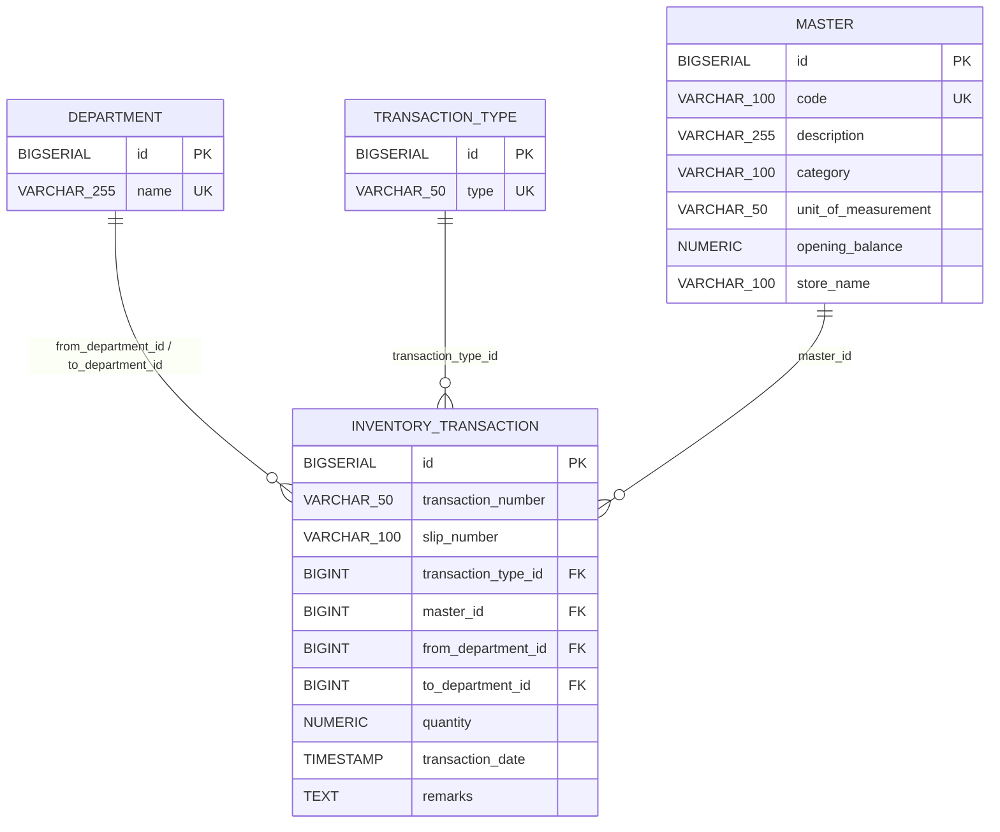
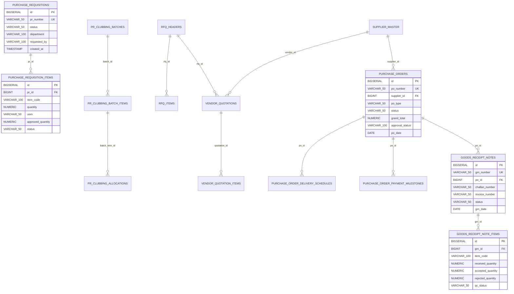
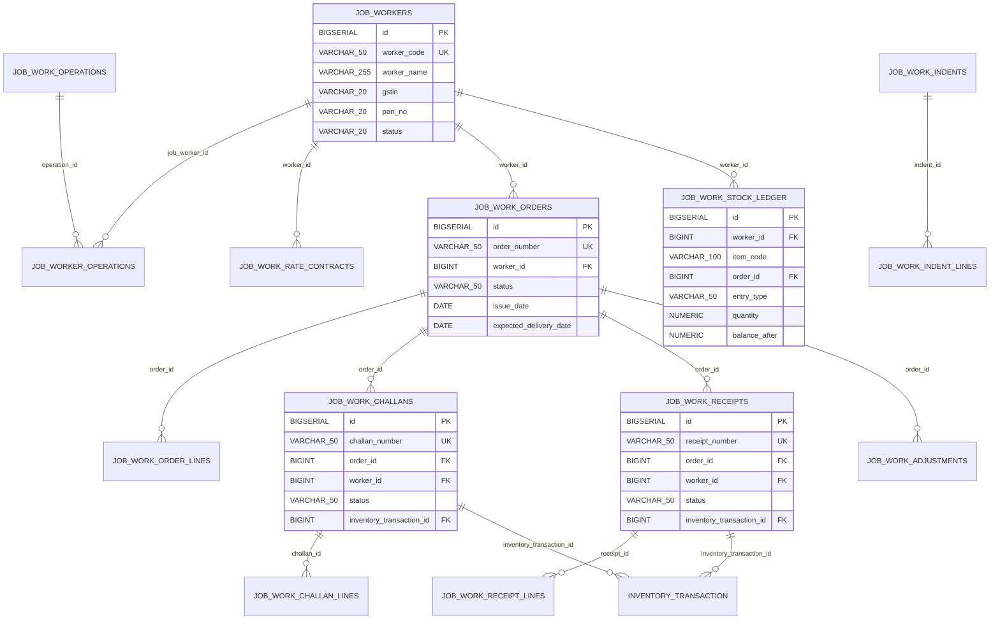
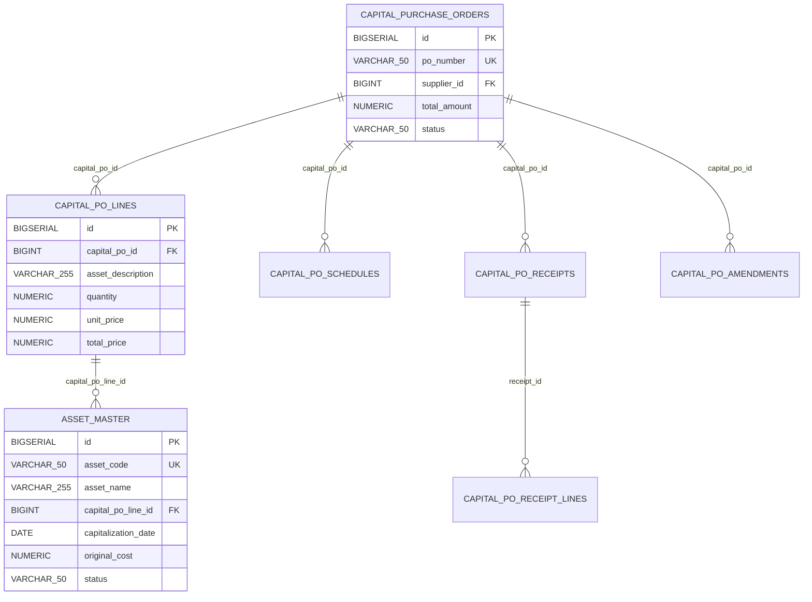

# Module-Specific Entity Relationship Diagrams — Silver Muller ERP

---

## 1. Core Inventory Ledger ERD

The core inventory engine is an append-only transaction ledger that calculates real-time stock balances across warehouse departments without storing fragile mutable summary totals.

---

## 2. Procurement & Purchasing ERD

Tracks the requisition lifecycle from internal PR to PR clubbing consolidation, RFQs, multi-vendor quotations, rate comparison, purchase order release, and goods receipt (GRN).

---

## 3. Job Work (Subcontracting) ERD

Tracks external manufacturing processing, dispatch challans, material accountability, worker stock ledgers, return receipts, quality grading, and scrap/loss adjustments.

---

## 4. Capital Purchase Orders & Fixed Assets ERD

Tracks high-value capital asset procurement, milestone schedules, inspection, capitalization into `asset_master`, and depreciation schedules.

