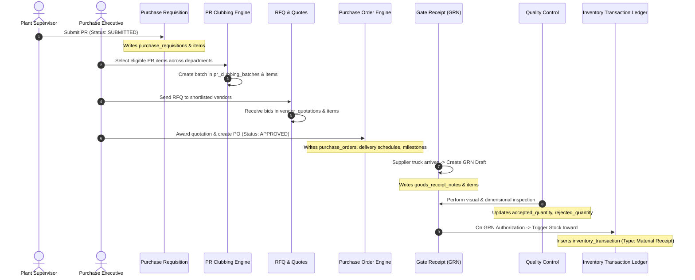
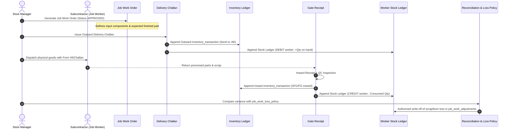

# Business Workflows & Data Flow — Silver Muller ERP

> Detailed functional execution paths, transaction boundaries, state lifecycles, and balance calculation algorithms.

---

## Workflow 1: Standard Procurement Lifecycle (PR → Clubbing → RFQ → PO → GRN)

### Sequence & Data Flow Diagram

### Transactional Mechanics & Calculations
- **Balance Calculation:** Stock is NOT incremented when a PO is issued. Stock is incremented only upon GRN QC acceptance.
- **Atomic Boundary:** The GRN approval creates the row in `goods_receipt_notes` and inserts the corresponding inward transaction in `inventory_transaction` within a single Spring `@Transactional` boundary.
- **Traceability Link:** `goods_receipt_note_items.inventory_transaction_id` records the foreign key back to the stock ledger.

---

## Workflow 2: Job Work (Subcontracting) Processing & Reconciliation

### Sequence & Data Flow Diagram

### Status Lifecycle & State Machine
1. **Job Work Order:** `DRAFT` → `PENDING_APPROVAL` → `APPROVED` → `IN_PROGRESS` → `PARTIALLY_RECEIVED` → `COMPLETED` → `CLOSED` / `CANCELLED`.
2. **Delivery Challan:** `DRAFT` → `ISSUED` → `DISPATCHED` → `CLOSED`.
3. **Receipt & Inspection:** `RECEIVED` → `UNDER_INSPECTION` → `ACCEPTED` / `REJECTED` → `POSTED_TO_STOCK`.

---

## Workflow 3: Moulding BOM Consumption & Finished Goods Recovery

1. **Trigger:** Production run completes for a compound or moulded rubber seal.
2. **Formula Retrieval:** The engine queries `fg_bom` to find active component ratios and `moulding_bom_mapping` for tooling.
3. **Atomic Multi-Transaction:**
   - Raw compound is deducted from `Moulding` department via negative row in `inventory_transaction`.
   - Finished moulded seal is credited to `FG STORE` via positive row in `inventory_transaction`.
   - Process scrap/flash is logged to `Rejection Store` for recycling/burning.
